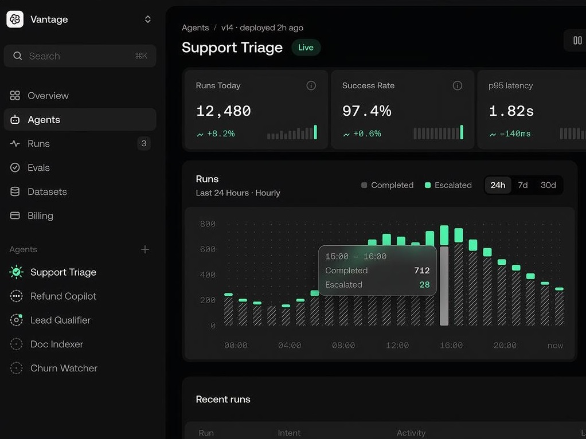
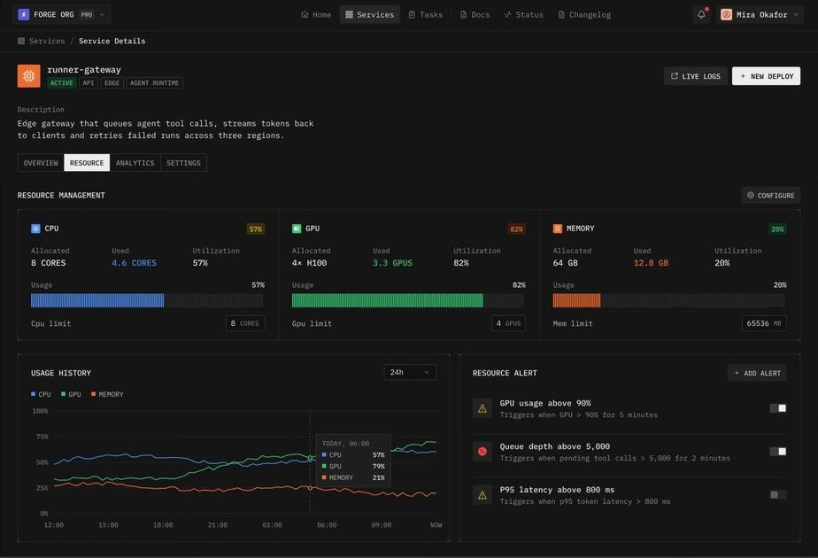
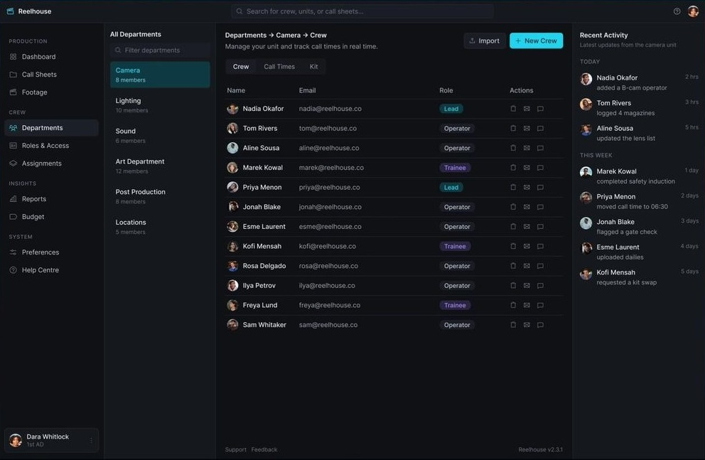
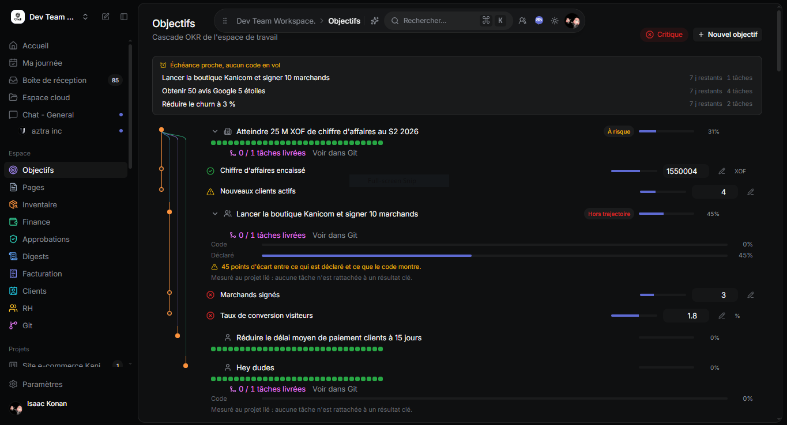
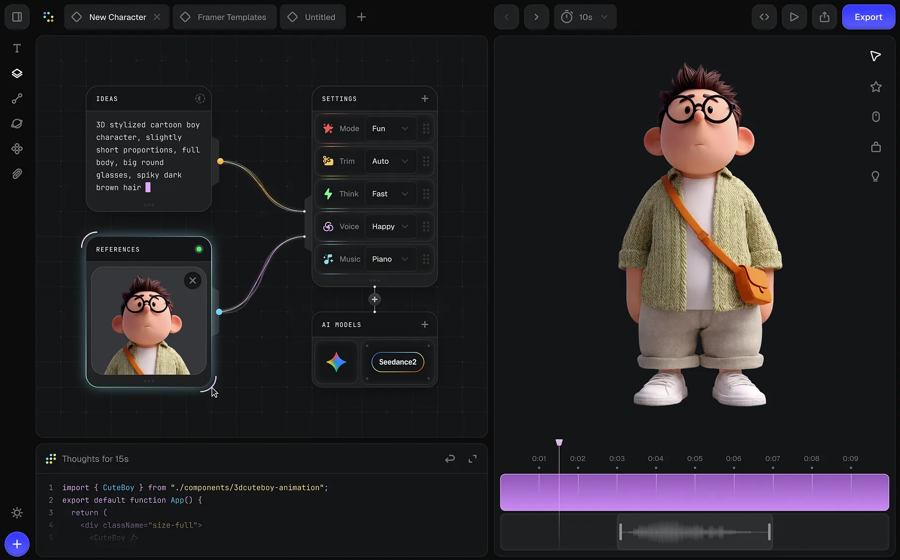
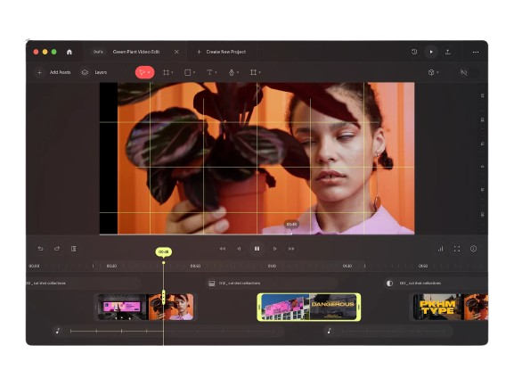

# rustx

Native software, written in Rust, drawn by a browser engine.

Components live in `.rsx` files — JSX's syntax, Rust's language — and a
`let mut` in one of them is state: no annotation, no macro, no
`store::`. npm libraries (React, Recharts, Tailwind, shadcn) are used
from the `.rsx` itself, and a project's `main.rs` is four lines, because
the ceremony is the framework's job.

Rust and React live in **the same process**: an `onClick` is a function
call, not a serialised message, and props cross the boundary as V8
values.

> **State of the work.** The workspace is `0.4.1` and on crates.io. The
> API can still move. Windows is written and measured; macOS and Linux
> compile, and each system call that is not written there refuses by
> naming the platform and the file that would implement it, rather than
> doing nothing quietly.

## Install

```sh
cargo install rustx-cli      # rustx new, dev, build, run
```

Rust 1.88 or newer, and nothing else: CEF — the browser engine — arrives
with the `cef` crate on the first build. An application that uses no npm
library needs neither Node nor npm. For JavaScript libraries, Node and
npm, like any project that uses them.

## A project

```sh
rustx new counter
cd counter
rustx dev
```

Four files matter. `main.rs` is the whole of the ceremony:

```rust
#[rustx::main]
fn main() -> rustx::Config {
    rustx::Config::new("Counter").size(900, 600)
}
```

`app/page.rsx` is the screen, and the state is a `let mut` at the top of
the file:

```rust
let mut count = 0;

fn Page() -> Element {
    return <main className="p-8">
        <h1>{count}</h1>
        <button onClick={move |_| count += 1}>"one more"</button>
    </main>;
}
```

That is the whole of it: mutating `count` marks the component dirty, and
the DOM is written once per frame. A file under `app/` is a route, a
`.rsx` beside it is a component, and a `{ … }` holds ordinary Rust —
`await` included.

## What has been built with it

Fourteen applications live in [`apps/`](apps), and they are what the
framework is proved against rather than illustrations drawn for a
README. Eight of them:

| | |
|---|---|
| **AI Agent Manager** — deploy and manage AI agents. Recharts, Tailwind, Lucide, Supabase, an LLM API, Axum, Reqwest. |  |
| **R Intelligent Data** — a full GUI for database management. shadcn tables, `git2`, the Docker CLI, a Kubernetes client. |  |
| **Vault-Storage Secure** — secret storage. A QR-code crate, a cyber-deck typeface, Tailwind. |  |
| **Monitor** — remote hardware tracking for agents: CPU, GPU, RAM, disk, network, tokens, and an alert to a human. |  |
| **MultiTask Hub** — orchestration across many projects at once. SeaORM, `git2`, Reqwest, shadcn, Tailwind v4. |  |
| **Utility Hub** — management for tech and finance startups: chat, webhooks, notifications, invoicing. |  |
| **Nemo Design** — a Blender-like 3D editor driven by agents. Three.js, ffmpeg, Rodio, shadcn. |  |
| **Altlassian Raw** — a small video editor: real cuts, trims, colour, burned-in subtitles, rendered by ffmpeg. |  |

## The documentation

**Everything is in the documentation, and the way to know this framework
is to run it locally.** Eighty-one pages, each with examples that
compile, and they are the source of the documentation site itself:

```sh
git clone https://github.com/AZTRA2022/rustx
cd rustx/site
npm install
npm run dev                  # http://localhost:3000
```

The pages are plain MDX in [`site/content/docs`](site/content/docs), so
they can also be read in an editor without running anything. What is
known to be missing or broken is one of those pages rather than a file
here: **what's left**.

This README is deliberately short. The long form of every subject —
attributes, props, lists and conditions, `keep`, `effect`, `task`,
routes and their waiting and falling over, async, worker threads,
JavaScript libraries, the window, what the web cannot do, the commands,
and what to do when it does not work — is there.

## The packages

Eight crates, all published at `0.4.1`.

| | |
|---|---|
| `rustx-app` | the facade: `App`, `Config`, `#[rustx::main]` — written `rustx::` |
| `rustx-cli` | `rustx new`, `dev`, `build`, `run` |
| `rustx-lsp` | what an editor asks about an `.rsx` |
| `rustx-compiler` | `.rsx` → `.rs`, and the position map |
| `rustx-dom` | the tree, the state, the diff, the routes |
| `rustx-engine` | the CEF host, the frame loop, the router |
| `rustx-os` | the clipboard, the dialogs, the tray, the rest of the system |
| `rustx-macro` | `#[rustx::main]`, `#[derive(ToValue)]` |

An application names one of them: `rustx-app`. The others come with it.
An application that outgrows the facade can call `rustx_engine`
directly: nothing is hidden, and every line the attribute adds is code
you could have written by hand.

## The editor

```sh
rustup component add rust-analyzer
cargo install rustx-lsp
code --install-extension editors/vscode/rustx-framework-extension-0.4.0.vsix
```

`.rsx` highlighting; the compiler's errors underlined at **their real
coordinates** in the `.rsx` and not in the generated Rust; completion of
tags, attributes, events, `style={{ … }}` keys and the file's own
components; completion of **the components of the installed libraries**,
read from `node_modules` and `components/ui`, with the library's name
beside each, and of what those tags take (`variant`, `size`, `asChild`
on a `<Button `); tag closing that leaves `Vec<u32>` and `=>` alone; and
inside a `{ … }`, `rust-analyzer` answering from behind the server.

## In this repository

| | |
|---|---|
| [`crates/`](crates) | the eight packages, each with its own README |
| [`apps/`](apps) | fourteen applications, which are what the plans are proved against |
| [`site/`](site) | the documentation, and the site that serves it |
| [`editors/vscode`](editors/vscode) | the extension |
| [`scripts/gates.ps1`](scripts/gates.ps1) | the quality gates |

The gates run with `powershell -File scripts/gates.ps1`, and `-List`
prints them. `.github/workflows/ci.yml` runs the same ones, plus the two
Node trees and the jobs that build, on Linux and macOS, the parts that
do not need CEF.

## The licence

MIT or Apache-2.0, at your choice — [`LICENSE-MIT`](LICENSE-MIT) and
[`LICENSE-APACHE`](LICENSE-APACHE).
